<a href="https://github.com/DDDuoDuo/EndfieldHUD/releases/tag/v1.3.1">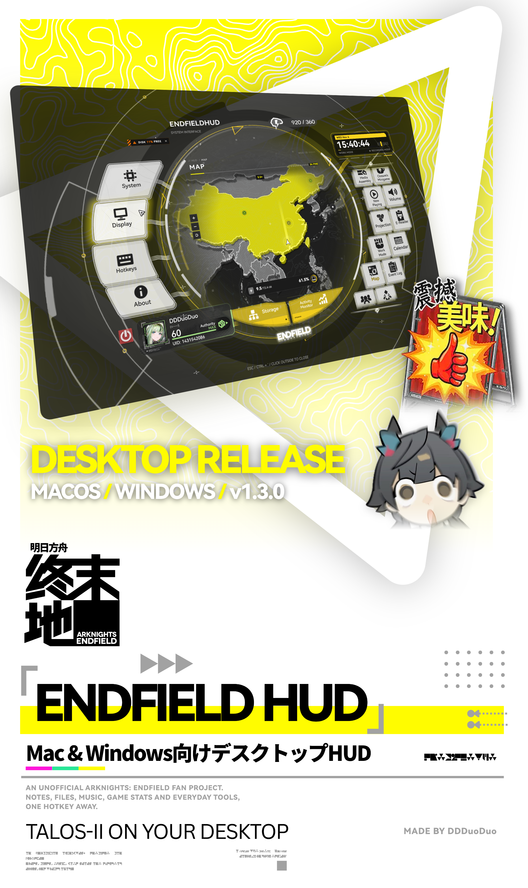</a>

  
  <a href="LICENSE">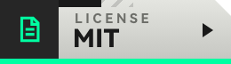</a>
  
  
  

  
  
  
  
  

  本物の管理人になれるアプリ 
  ショートカットやメニューバーから、エンドフィールドの端末を開けます——メモ、ファイル、音楽、ゲームの情報、毎日使うツールをひとまとめに

 

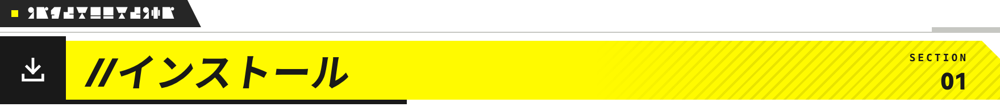

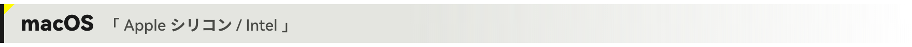

<a href="https://github.com/DDDuoDuo/EndfieldHUD/releases/tag/v1.3.1">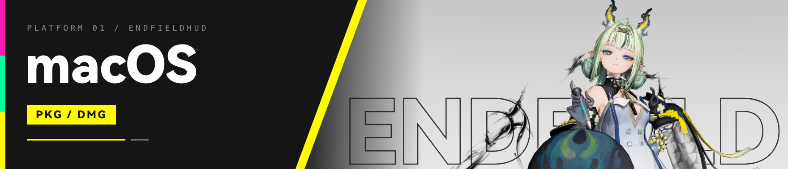</a>

※ EndfieldHUD はメニューバーに表示されます。ショートカットひとつで、すべてのアプリの上に HUD が開きます

<table>
<tr>
<td width="120"></td>
<td><a href="https://github.com/DDDuoDuo/EndfieldHUD/releases/download/v1.3.1/EndfieldHUD-1.3.1-build20-Installer.pkg"><b>PKG インストーラ</b></a> / <a href="https://github.com/DDDuoDuo/EndfieldHUD/releases/download/v1.3.1/EndfieldHUD-1.3.1-build20-macOS.dmg"><b>DMG</b></a> / <a href="https://github.com/DDDuoDuo/EndfieldHUD/releases">すべてのリリース</a></td>
</tr>
<tr>
<td></td>
<td>すでに EndfieldHUD を使っている場合は、メニューバーの <b>更新を確認</b>をクリック</td>
</tr>
<tr>
<td></td>
<td>1. DMG を開いて <b>EndfieldHUD.app</b> を <b>Applications（アプリケーション）</b> にドラッグするか、PKG インストーラを実行します。 2. 「アプリケーション」から EndfieldHUD を開くと、メニューバーにアイコンが表示されます</td>
</tr>
<tr>
<td></td>
<td><kbd>Ctrl</kbd> + <kbd>`</kbd> で HUD を開きます（<a href="docs/system-overlay.md">しくみ</a>）。キーは <b>設定</b>で変更できます</td>
</tr>
</table>

> [!WARNING]
> macOS にブロックされた場合は、**システム設定 → プライバシーとセキュリティ → このまま開く**から確認して開いてください。アプリがまだ Apple の公証を受けていないためです

 

<a href="https://github.com/DDDuoDuo/EndfieldHUD/releases/tag/v1.3.1">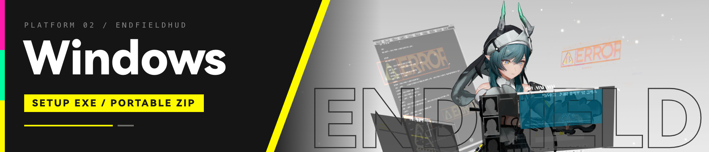</a>

※ Windows では、EndfieldHUD は通知領域（システムトレイ）に常駐します。HUD もショートカットも Mac と同じです

<table>
<tr>
<td width="120"></td>
<td><a href="https://github.com/DDDuoDuo/EndfieldHUD/releases/download/v1.3.1/EndfieldHUD-1.3.1-build20-windows-x64-setup.exe"><b>セットアップ（EXE）</b></a> / <a href="https://github.com/DDDuoDuo/EndfieldHUD/releases/download/v1.3.1/EndfieldHUD-1.3.1-build20-windows-x64-portable.zip"><b>ポータブル版（ZIP）</b></a> / <a href="https://github.com/DDDuoDuo/EndfieldHUD/releases">すべてのリリース</a></td>
</tr>
<tr>
<td></td>
<td>すでに EndfieldHUD を使っている場合は、<b>このアプリについて</b>の <b>アップデートを確認</b>をクリックするか、新しいセットアップで上書きインストールします。データは残ります</td>
</tr>
<tr>
<td></td>
<td>1. セットアップを実行し（管理者権限はいりません）、画面の案内に沿ってインストールします。完了するとスタートメニューに EndfieldHUD が追加されます。 2. PC の起動時に自動で起動したい場合は、<b>ログイン時に起動</b>にチェックを入れます。<b>インストール</b>を選び、続けて <b>EndfieldHUD を開く</b>を選びます</td>
</tr>
<tr>
<td></td>
<td>アイコンはメニューバーではなく、通知領域（システムトレイ）に表示されます。Mac と同じく <kbd>Ctrl</kbd> + <kbd>`</kbd> で HUD を開きます。キーは <b>ショートカット</b>で変更できます</td>
</tr>
<tr>
<td></td>
<td>インストールしたくない場合は、ZIP 版を好きな場所に展開して <b>EndfieldHUD.exe</b> を実行するだけです。ただし、スタートメニューには追加されず、カレンダーのリマインダー通知も届きません</td>
</tr>
<tr>
<td></td>
<td>アンインストールするには、<b>設定 → アプリ → インストールされているアプリ → EndfieldHUD → アンインストール</b>を選びます。<b>EndfieldHUD のデータも削除する</b>にチェックを入れない限り、データは残ります</td>
</tr>
</table>

> [!WARNING]
> Windows SmartScreen に **Windows によって PC が保護されました** と表示された場合は、**詳細情報 → 実行**を選んでください。アプリは署名済みですが、新しいバージョンは実行した人が十分に増えるまで SmartScreen が警告することがあります

 

<a href="https://github.com/OctoberPrayRain/HyprEndfield">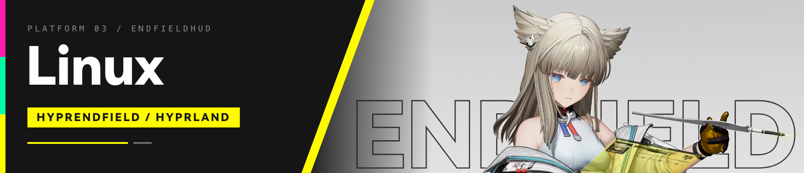</a>

<table>
<tr>
<td width="120"></td>
<td><a href="https://github.com/OctoberPrayRain/HyprEndfield"><b>HyprEndfield</b></a>（作者：<a href="https://github.com/OctoberPrayRain">OctoberPrayRain</a>）</td>
</tr>
</table>

> [!WARNING]
> HyprEndfield は OctoberPrayRain さんが作ったコミュニティ移植版で、私が作ったものではありません。ご利用は自己責任でお願いします。使用によって生じたいかなる損失についても責任を負いません

 

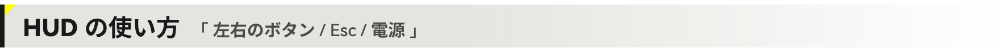

<table>
<tr>
<td width="120"></td>
<td>左右のボタンで画面を切り替え、右側はスクロールできます。<b>Esc</b> は編集中の項目を先に閉じ、その後 HUD を閉じます。HUD を閉じてもアプリは動き続けます。終了するには赤い電源ボタンを押すか、メニューバーのアイコンを右クリックしてください</td>
</tr>
</table>

 

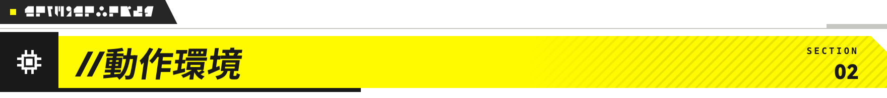

<table>
<tr>
<td width="120"></td>
<td>Apple M シリーズチップ：<b>macOS 11 以降</b>。Intel：<b>macOS 10.15.4 以降</b>。一部の機能には、より新しい OS や対応するハードウェアが必要です</td>
</tr>
<tr>
<td></td>
<td><b>Windows 11（64 ビット、x64）</b>。Windows 10 と ARM64 には対応していません。Direct3D 11 に対応したグラフィックカードと、約 64 MiB のディスク容量が必要です</td>
</tr>
</table>

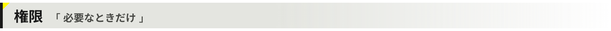

必要な機能を使うときに、次の権限を許可してください。

| 権限 | 用途 |
| --- | --- |
| **アクセシビリティ** | 作業モードからコントロールセンターを通じて macOS の集中モードを切り替えます。許可なしでもタイマーは使えます |
| **システムオーディオ録音** | macOS 14.2 以降の実験的なアプリ別音量調整に使います。音声は保存しません |
| **オートメーション** | 対応する音楽アプリの操作に使います。macOS に確認されたときに許可してください |
| **通知** | 更新のお知らせとカレンダーのリマインダーに使います |
| **ファイルとフォルダ** | 自分で選んだファイル、画像、動画を開くために使います |

> [!TIP]
> 権限は **システム設定 → プライバシーとセキュリティ**で確認できます。通知は専用の設定画面があります

 

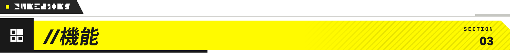

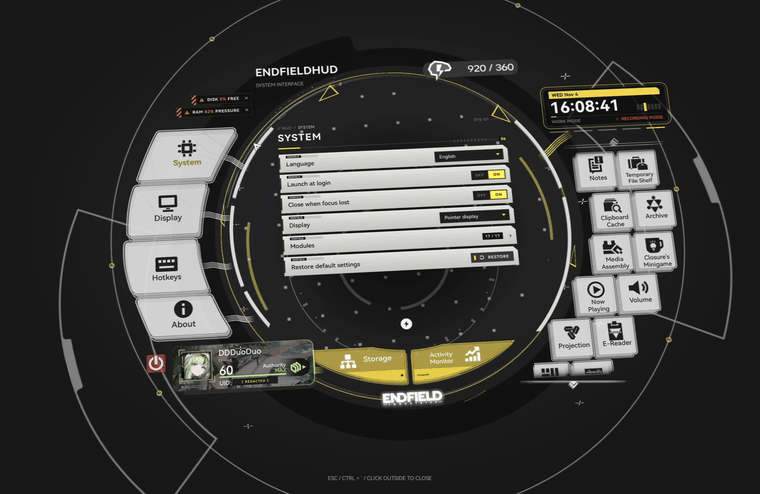

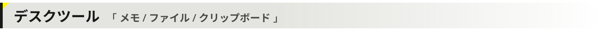

| ツール | できること |
| --- | --- |
| [**メモ**](docs/notes-canvas.md) | 文字や絵、ToDo リスト、画像、動画を追加できます。パネルをピン留めすれば、別のモジュールに切り替えても消えません |
| [**一時ファイルシェルフ**](docs/file-shelf.md) | ファイルをドロップしてプレビューし、また取り出せます。元のファイルは元の場所に残ります |
| [**クリップボードキャッシュ**](docs/clipboard-cache.md) | 最近コピーしたテキスト、リンク、画像、ファイルを見返せます。履歴はアプリ終了時に消えます |
| [**アーカイブ**](docs/archive.md) | 文書を自分のカテゴリで整理できます。文字の装飾や画像・動画にも対応しています |
| [**アプリのショートカット**](docs/app-shortcuts.md) | 好きな名前とアイコンでアプリを追加できます |

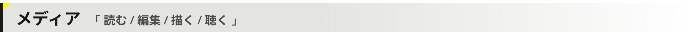

| ツール | できること |
| --- | --- |
| [**電子リーダー**](docs/reader.md) | 小説や PDF を読み、しおりを付けたり拡大したりできます |
| [**メディア編集**](docs/media-assembly.md) | 画像や動画の切り抜き、色などの調整、フィルター、ステッカーを使えます |
| [**プロジェクション**](docs/projection.md) | 画面いっぱいのキャンバスに描けます。ドットの背景も選べます |
| [**再生中**](docs/now-playing.md) | アルバムアートや取得できる歌詞を表示し、再生を操作できます |

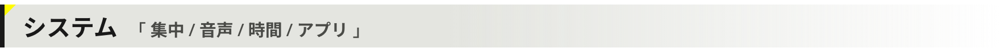

| ツール | できること |
| --- | --- |
| [**作業モード・音量**](docs/audio-and-work-mode.md) | 集中モードへの切り替えや音声デバイスの変更、[対応する音量の調整](docs/per-app-audio.md)ができます |
| [**カレンダー**](docs/calendar.md) | タイマーやストップウォッチを使い、予定とリマインダーを登録できます |
| [**バッテリー・ストレージ・アクティビティモニタ**](docs/storage-and-activity.md) | 充電状態、ディスク容量、CPU、RAM、実行中のアプリを確認できます |

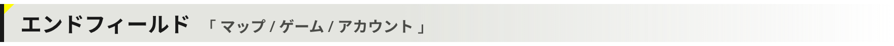

| ツール | できること |
| --- | --- |
| [**マップ**](docs/map.md) | オフラインの地形図を見て、ピンを置いたりカスタマイズしたりできます |
| [**クロージャのミニゲーム**](docs/orbipom-runtime.md) | 「バブル、合体！」で遊べます |
| [**イベントログ**](docs/event-log.md) | 管理人になった気分で、イベントログをチェックできます |
| [**個人 ID**](docs/personal-profile.md) | 自分のカードをカスタマイズできます。プロフィール情報は自由に編集できます |
| [**アカウント連携**](docs/account-linking.md) | HYPERGRYPH のゲームアカウントを連携すると、プロフィール情報や理性の回復カウントダウンを表示できます |

※ アカウント連携は任意です

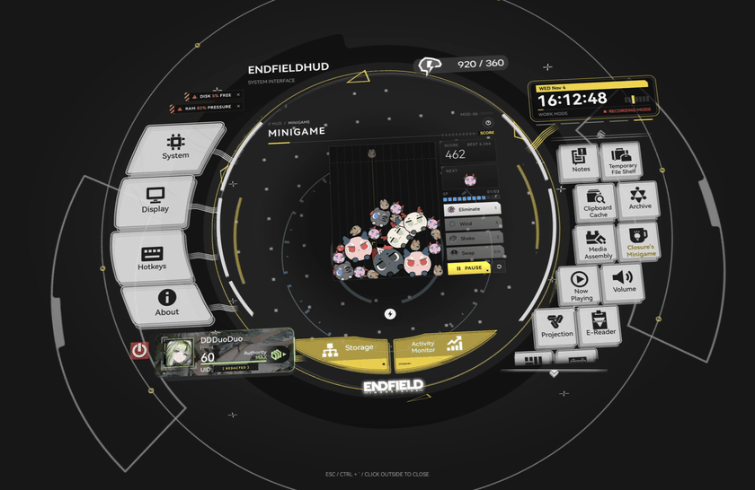

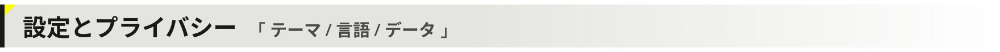

<table>
<tr>
<td width="120"></td>
<td><a href="docs/settings.md"><b>設定</b></a>では、テーマ、傾き、時計、アイコン、アニメーションを変更できます</td>
</tr>
<tr>
<td></td>
<td>HUD は英語、簡体字中国語、繁体字中国語、日本語、韓国語に対応しています</td>
</tr>
<tr>
<td></td>
<td>メモや設定はこの Mac に保存されます。連携したコミュニティアカウントの認証情報は macOS のキーチェーンに保存します。更新は GitHub から届きます。メニューバーか <b>このアプリについて</b>で更新の確認や設定ができます</td>
</tr>
</table>

 

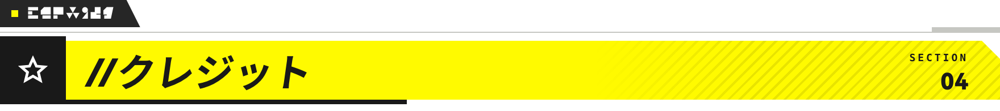

<table>
<tr>
<td width="120"></td>
<td><a href="https://github.com/DDDuoDuo">DDDuoDuo</a></td>
</tr>
<tr>
<td></td>
<td>『アークナイツ：エンドフィールド』、<a href="https://github.com/QinAnze/zmd-charge">QinAnze</a>、<a href="https://www.bilibili.com/video/BV1DBaP6yEHs/">llynxxx</a></td>
</tr>
<tr>
<td></td>
<td>オリジナルのコードは <a href="LICENSE">MIT ライセンス</a>で公開しています。第三者の素材やライブラリには、それぞれの利用条件が適用されます。<a href="CREDITS.md">クレジット一覧</a></td>
</tr>
</table>

※ 非公式のファンプロジェクトです。ゲームの画像やブランドの権利は HYPERGRYPH および各権利者に帰属します

Windows 版のコード署名は <a href="https://about.signpath.io/">SignPath.io</a> が無償で提供し、証明書は <a href="https://signpath.org/">SignPath Foundation</a> が発行しています。<a href="CODE-SIGNING.md">コード署名ポリシー</a>

 

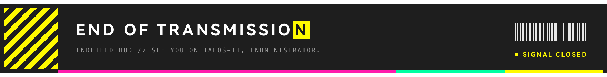

