<a href="https://github.com/DDDuoDuo/EndfieldHUD/releases/tag/v1.3.1">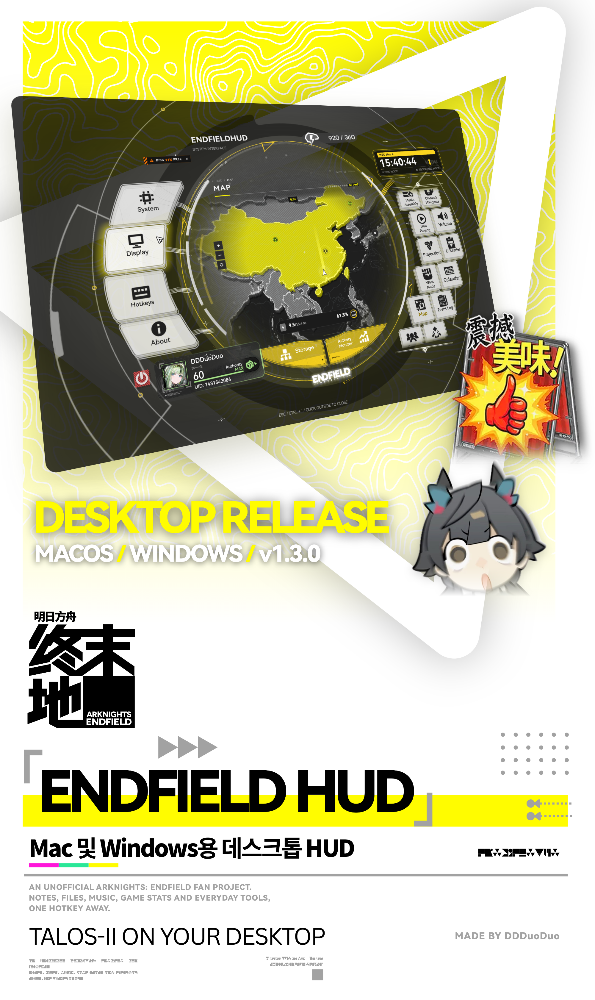</a>

  
  <a href="LICENSE">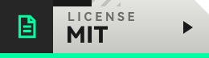</a>
  
  
  

  
  
  
  
  

  진짜 관리자가 될 수 있는 앱 
  단축키를 누르거나 메뉴 막대를 클릭하기만 하면 엔드필드의 단말기가 열려요 — 메모, 파일, 음악, 게임 정보와 다양한 일상 도구를 이용할 수 있어요

 

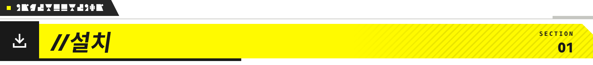

<a href="https://github.com/DDDuoDuo/EndfieldHUD/releases/tag/v1.3.1">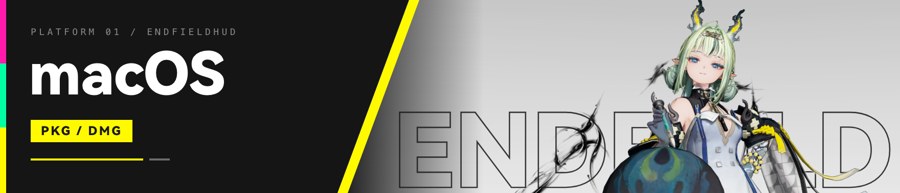</a>

※ EndfieldHUD는 메뉴 막대에 나타나요. 단축키 하나로 모든 앱 위에 HUD가 열려요

<table>
<tr>
<td width="120"></td>
<td><a href="https://github.com/DDDuoDuo/EndfieldHUD/releases/download/v1.3.1/EndfieldHUD-1.3.1-build20-Installer.pkg"><b>PKG 설치 프로그램</b></a> / <a href="https://github.com/DDDuoDuo/EndfieldHUD/releases/download/v1.3.1/EndfieldHUD-1.3.1-build20-macOS.dmg"><b>DMG</b></a> / <a href="https://github.com/DDDuoDuo/EndfieldHUD/releases">모든 릴리스</a></td>
</tr>
<tr>
<td></td>
<td>EndfieldHUD가 이미 설치되어 있나요? 메뉴 막대에서 <b>업데이트 확인</b>을 클릭하세요</td>
</tr>
<tr>
<td></td>
<td>1. DMG를 열어 <b>EndfieldHUD.app</b>을 <b>응용 프로그램</b>으로 드래그하거나 PKG 설치 프로그램을 실행하세요. 2. 응용 프로그램에서 EndfieldHUD를 열고 메뉴 막대의 아이콘을 확인하세요</td>
</tr>
<tr>
<td></td>
<td><kbd>Ctrl</kbd> + <kbd>`</kbd>을 누르면 HUD가 열려요(<a href="docs/system-overlay.md">작동 방식</a>). 단축키는 <b>설정</b>에서 바꿀 수 있어요</td>
</tr>
</table>

> [!WARNING]
> macOS가 앱 실행을 차단하면 **시스템 설정 → 개인정보 보호 및 보안 → 확인 없이 열기**에서 실행을 허용하세요. 아직 Apple 공증을 받지 않은 앱이기 때문이에요

 

<a href="https://github.com/DDDuoDuo/EndfieldHUD/releases/tag/v1.3.1">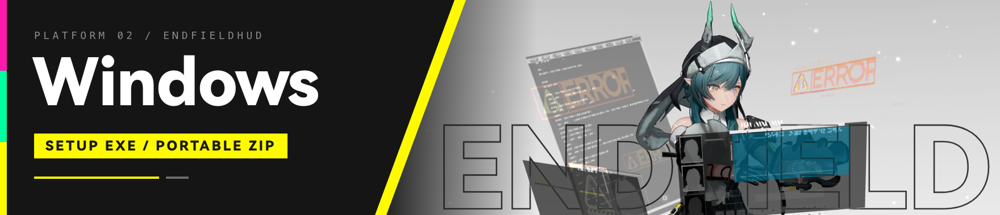</a>

※ Windows에서는 EndfieldHUD가 알림 영역(시스템 트레이)에 있어요. HUD도 단축키도 같아요

<table>
<tr>
<td width="120"></td>
<td><a href="https://github.com/DDDuoDuo/EndfieldHUD/releases/download/v1.3.1/EndfieldHUD-1.3.1-build20-windows-x64-setup.exe"><b>설치 프로그램(EXE)</b></a> / <a href="https://github.com/DDDuoDuo/EndfieldHUD/releases/download/v1.3.1/EndfieldHUD-1.3.1-build20-windows-x64-portable.zip"><b>포터블(ZIP)</b></a> / <a href="https://github.com/DDDuoDuo/EndfieldHUD/releases">모든 릴리스</a></td>
</tr>
<tr>
<td></td>
<td>EndfieldHUD가 이미 설치되어 있나요? <b>정보</b>에서 <b>업데이트 확인</b>을 클릭하거나, 새 버전 설치 프로그램으로 덮어 설치하세요. 데이터는 남아요</td>
</tr>
<tr>
<td></td>
<td>1. 설치 프로그램을 실행하고(관리자 권한 필요 없음) 화면의 안내에 따라 설치하세요. 설치가 끝나면 시작 메뉴에 EndfieldHUD가 추가돼요. 2. 컴퓨터를 켤 때 자동으로 실행하려면 <b>로그인 시 실행</b>을 체크하세요. <b>설치</b>를 누른 다음 <b>EndfieldHUD 열기</b>를 누르세요</td>
</tr>
<tr>
<td></td>
<td>아이콘은 메뉴 막대가 아니라 알림 영역(시스템 트레이)에 있어요. Mac과 마찬가지로 <kbd>Ctrl</kbd> + <kbd>`</kbd>을 누르면 HUD가 열리고, 단축키는 <b>단축키</b>에서 바꿀 수 있어요</td>
</tr>
<tr>
<td></td>
<td>설치 없이 쓰고 싶다면 ZIP 버전을 원하는 곳에 압축 해제하고 <b>EndfieldHUD.exe</b>를 실행하면 돼요. 다만 시작 메뉴에 추가되지 않고, 달력 미리 알림도 받을 수 없어요</td>
</tr>
<tr>
<td></td>
<td>제거하려면 <b>설정 → 앱 → 설치된 앱 → EndfieldHUD → 제거</b>로 가세요. <b>EndfieldHUD 데이터도 삭제</b>를 체크하지 않으면 데이터는 그대로 남아요</td>
</tr>
</table>

> [!WARNING]
> Windows SmartScreen에 **Windows의 PC 보호** 창이 뜨면 **추가 정보 → 실행**을 누르세요. 아직 코드 서명을 하지 않은 앱이기 때문이에요

 

<a href="https://github.com/OctoberPrayRain/HyprEndfield">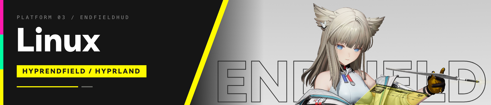</a>

<table>
<tr>
<td width="120"></td>
<td><a href="https://github.com/OctoberPrayRain/HyprEndfield"><b>HyprEndfield</b></a> (제작: <a href="https://github.com/OctoberPrayRain">OctoberPrayRain</a>)</td>
</tr>
</table>

> [!WARNING]
> HyprEndfield는 OctoberPrayRain 님이 만든 커뮤니티 포팅판으로, 제가 만든 것이 아니에요. 사용에 따른 위험은 직접 감수해야 하며, 사용으로 생긴 어떤 손실에도 책임지지 않아요

 

<table>
<tr>
<td width="120"></td>
<td>옆쪽 버튼으로 섹션을 바꾸고, 오른쪽은 스크롤할 수 있어요. <b>Esc</b>를 누르면 먼저 편집에서 빠져나온 뒤 HUD가 닫혀요. HUD를 닫아도 앱은 계속 실행되며, 빨간 전원 버튼을 누르거나 메뉴 막대 아이콘을 오른쪽 클릭하면 앱을 종료할 수 있어요</td>
</tr>
</table>

 

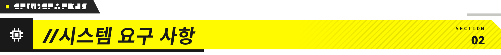

<table>
<tr>
<td width="120"></td>
<td>Apple M 시리즈 칩: <b>macOS 11 이상</b>. Intel: <b>macOS 10.15.4 이상</b>. 일부 도구에는 더 최신 시스템이나 지원되는 하드웨어가 필요해요</td>
</tr>
<tr>
<td></td>
<td><b>Windows 11 64비트(x64)</b>. ARM64와 Windows 10은 지원하지 않아요. Direct3D 11을 지원하는 그래픽 카드와 약 64MiB의 디스크 공간이 필요해요</td>
</tr>
</table>

권한이 필요한 기능을 사용할 때 해당 권한을 허용하세요.

| 권한 | 용도 |
| --- | --- |
| **손쉬운 사용** | 작업 모드에서 제어 센터를 통해 macOS 집중 모드를 전환해요. 권한이 없어도 타이머는 작동해요 |
| **시스템 오디오 녹음** | macOS 14.2 이상에서 실험적인 앱별 음량 조절에 사용해요. 오디오는 저장하지 않아요 |
| **자동화** | macOS가 요청할 때 허용하면 지원되는 음악 앱을 제어할 수 있어요 |
| **알림** | 업데이트 알림과 달력 미리 알림에 사용해요 |
| **파일 및 폴더** | 직접 선택한 파일, 사진, 동영상을 열 때 사용해요 |

> [!TIP]
> 권한은 **시스템 설정 → 개인정보 보호 및 보안**에서 확인할 수 있어요. 알림은 별도 설정 페이지에서 관리해요

 

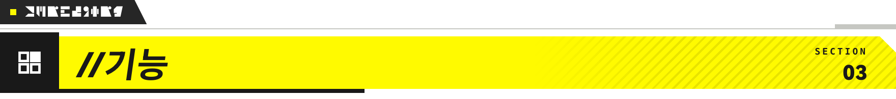

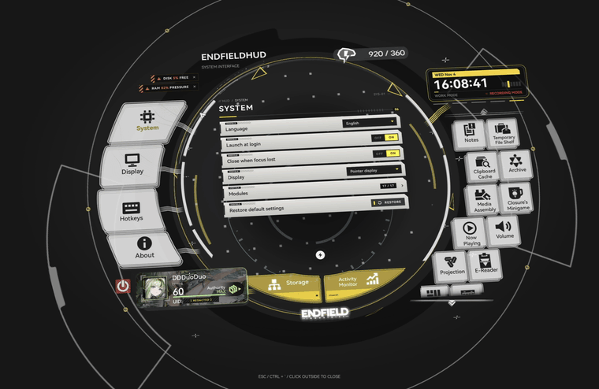

| 도구 | 할 수 있는 일 |
| --- | --- |
| [**메모**](docs/notes-canvas.md) | 글을 쓰고, 그림을 그리고, 할 일 목록이나 이미지, 동영상을 추가해요. 패널을 고정하면 다른 모듈로 바꿔도 사라지지 않아요 |
| [**임시 파일 보관함**](docs/file-shelf.md) | 파일을 드롭해 미리 보고 다시 꺼낼 수 있어요. 원본은 원래 위치에 남아요 |
| [**클립보드 캐시**](docs/clipboard-cache.md) | 최근 복사한 텍스트, 링크, 이미지, 파일을 스크롤하며 살펴봐요. 앱을 종료하면 기록이 지워져요 |
| [**아카이브**](docs/archive.md) | 서식 있는 텍스트와 미디어를 담은 문서를 원하는 분류로 보관해요 |
| [**앱 바로가기**](docs/app-shortcuts.md) | 원하는 이름과 아이콘으로 앱을 추가해요 |

| 도구 | 할 수 있는 일 |
| --- | --- |
| [**리더**](docs/reader.md) | 소설과 PDF를 읽고, 책갈피를 추가하고, 확대해서 볼 수 있어요 |
| [**미디어 편집**](docs/media-assembly.md) | 사진과 동영상을 자르고, 보정하고, 필터와 스티커를 넣어요 |
| [**화면 필기**](docs/projection.md) | 화면 크기의 캔버스에 그림을 그려요. 점무늬 배경도 켤 수 있어요 |
| [**지금 재생 중**](docs/now-playing.md) | 앨범 아트와 제공되는 가사를 보고 재생을 제어해요 |

| 도구 | 할 수 있는 일 |
| --- | --- |
| [**작업 모드와 음량**](docs/audio-and-work-mode.md) | 집중 모드를 켜고, 오디오 장치를 바꾸고, [지원되는 음량 조절 기능](docs/per-app-audio.md)을 사용해요 |
| [**달력**](docs/calendar.md) | 타이머나 스톱워치를 실행하고, 미리 알림이 있는 일정을 저장해요 |
| [**배터리, 저장 공간과 활성 상태 보기**](docs/storage-and-activity.md) | 충전 상태, 디스크 공간, CPU, RAM, 실행 중인 앱을 확인해요 |

| 도구 | 할 수 있는 일 |
| --- | --- |
| [**지도**](docs/map.md) | 오프라인 지형 지도를 둘러보고 핀을 추가하거나 꾸며요 |
| [**클로저의 미니게임**](docs/orbipom-runtime.md) | '융합! 버블!'을 즐겨보세요 |
| [**이벤트 로그**](docs/event-log.md) | 진짜 관리자처럼 이벤트 로그를 확인해보세요 |
| [**개인 프로필**](docs/personal-profile.md) | 나만의 카드를 꾸며요. 프로필 정보를 자유롭게 편집할 수 있어요 |
| [**계정 연동**](docs/account-linking.md) | HYPERGRYPH 게임 계정을 연동해 프로필 정보와 이성 회복까지 남은 시간을 확인해요 |

※ 계정 연동은 선택 사항이에요

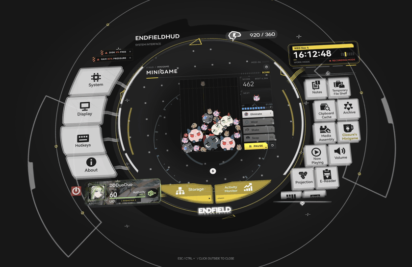

<table>
<tr>
<td width="120"></td>
<td><a href="docs/settings.md"><b>설정</b></a>에서 테마, 기울기, 시계, 아이콘, 애니메이션을 바꿀 수 있어요</td>
</tr>
<tr>
<td></td>
<td>HUD는 영어, 중국어 간체, 중국어 번체, 일본어, 한국어를 지원해요</td>
</tr>
<tr>
<td></td>
<td>메모와 설정은 Mac에 저장돼요. 연동한 커뮤니티 계정의 인증 정보는 macOS 키체인에 보관해요. 업데이트는 GitHub에서 받아요. 메뉴 막대나 <b>정보</b>에서 업데이트를 관리할 수 있어요</td>
</tr>
</table>

 

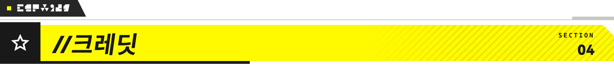

<table>
<tr>
<td width="120"></td>
<td><a href="https://github.com/DDDuoDuo">DDDuoDuo</a></td>
</tr>
<tr>
<td></td>
<td><i>명일방주: 엔드필드</i>, <a href="https://github.com/QinAnze/zmd-charge">QinAnze</a>, <a href="https://www.bilibili.com/video/BV1DBaP6yEHs/">llynxxx</a></td>
</tr>
<tr>
<td></td>
<td>직접 작성한 코드는 <a href="LICENSE">MIT 라이선스</a>를 따르며, 타사 에셋과 라이브러리에는 각각의 이용 조건이 적용돼요. <a href="CREDITS.md">전체 크레딧</a></td>
</tr>
</table>

※ 비공식 팬 프로젝트예요. 게임 아트워크와 브랜드의 권리는 HYPERGRYPH와 각 권리자에게 있어요

 

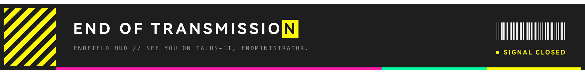

