<a href="https://github.com/DDDuoDuo/EndfieldHUD/releases/tag/v1.3.0">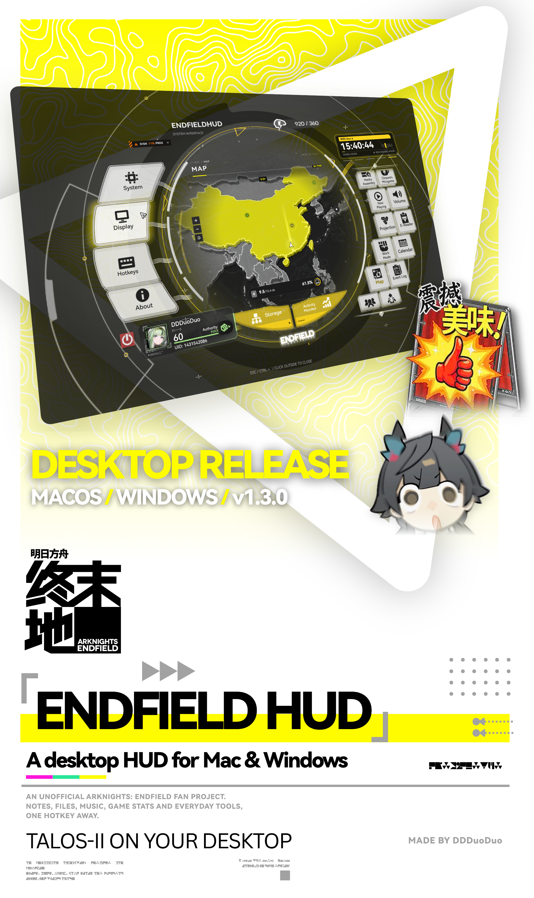</a>

  
  <a href="LICENSE">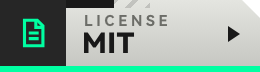</a>
  
  
  

  
  
  
  
  

  A little bit of <i>Arknights: Endfield</i> on your Mac or Windows PC. 
  Open a layered, animated HUD with a hotkey or from the menu bar for notes, files, music, game stats, and everyday tools.

 

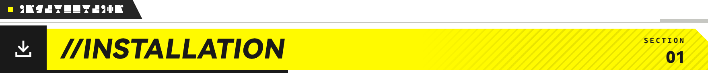

<a href="https://github.com/DDDuoDuo/EndfieldHUD/releases/tag/v1.3.0">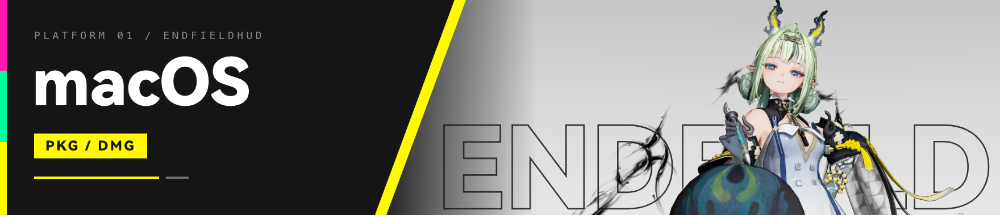</a>

※ EndfieldHUD lives in the menu bar. One hotkey brings the HUD up over whatever you're doing.

<table>
<tr>
<td width="120"></td>
<td><a href="https://github.com/DDDuoDuo/EndfieldHUD/releases/download/v1.3.0/EndfieldHUD-1.3.0-build19-Installer.pkg"><b>PKG installer</b></a> / <a href="https://github.com/DDDuoDuo/EndfieldHUD/releases/download/v1.3.0/EndfieldHUD-1.3.0-build19-macOS.dmg"><b>DMG</b></a> / <a href="https://github.com/DDDuoDuo/EndfieldHUD/releases">All releases</a></td>
</tr>
<tr>
<td></td>
<td>Already installed? Click <b>Check Update</b> in the menu bar.</td>
</tr>
<tr>
<td></td>
<td>1. Open the DMG and drag <b>EndfieldHUD.app</b> into <b>Applications</b>, or run the PKG installer. 2. Open EndfieldHUD from Applications. Look for its icon in the menu bar.</td>
</tr>
<tr>
<td></td>
<td>Press <kbd>Ctrl</kbd> + <kbd>`</kbd> to open the HUD (<a href="docs/system-overlay.md">how it works</a>). You can change the hotkey in <b>Hotkeys</b>.</td>
</tr>
</table>

> [!WARNING]
> If macOS blocks the app, go to **System Settings → Privacy & Security → Open Anyway**, then confirm. The app isn't notarized by Apple yet.

 

<a href="https://github.com/DDDuoDuo/EndfieldHUD/releases/tag/v1.3.0">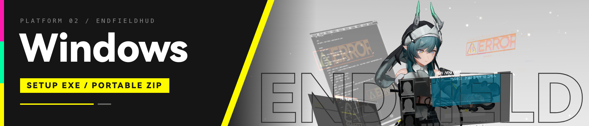</a>

※ On Windows, EndfieldHUD lives in the notification area (system tray). Same HUD, same hotkey.

<table>
<tr>
<td width="120"></td>
<td><a href="https://github.com/DDDuoDuo/EndfieldHUD/releases/download/v1.3.0/EndfieldHUD-1.3.0-build19-windows-x64-setup.exe"><b>Setup EXE</b></a> / <a href="https://github.com/DDDuoDuo/EndfieldHUD/releases/download/v1.3.0/EndfieldHUD-1.3.0-build19-windows-x64-portable.zip"><b>Portable ZIP</b></a> / <a href="https://github.com/DDDuoDuo/EndfieldHUD/releases">All releases</a></td>
</tr>
<tr>
<td></td>
<td>Already installed? Click <b>Check for updates</b> in <b>About</b>, or run a newer setup over it. Your data stays.</td>
</tr>
<tr>
<td></td>
<td>1. Run the setup. It installs for your account only (no administrator permission needed) and adds EndfieldHUD to the Start menu. 2. Keep <b>Launch at login</b> ticked if you want it to start when you sign in. Choose <b>Install</b>, then <b>Open EndfieldHUD</b>.</td>
</tr>
<tr>
<td></td>
<td>Look for its icon in the notification area instead of the menu bar. Press <kbd>Ctrl</kbd> + <kbd>`</kbd> to open the HUD, same as on the Mac. You can change it in <b>Hotkeys</b>.</td>
</tr>
<tr>
<td></td>
<td>Don't want to install? Unzip the portable ZIP anywhere and run <b>EndfieldHUD.exe</b>. It has no Start menu entry and no Calendar reminder notifications.</td>
</tr>
<tr>
<td></td>
<td>Go to <b>Settings → Apps → Installed apps → EndfieldHUD → Uninstall</b>. Your data stays unless you tick <b>Also delete my EndfieldHUD data</b>.</td>
</tr>
</table>

> [!WARNING]
> If Windows SmartScreen shows **Windows protected your PC**, choose **More info → Run anyway**. The app isn't code-signed yet.

 

<table>
<tr>
<td width="120"></td>
<td>Use the side buttons to switch sections, and scroll the right side for more. <b>Esc</b> backs out of an edit before closing the HUD. Closing it keeps the app running; the red power button quits the app.</td>
</tr>
</table>

 

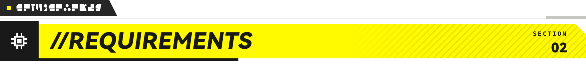

<table>
<tr>
<td width="120"></td>
<td>Apple silicon: <b>macOS 11+</b>. Intel: <b>macOS 10.15.4+</b>. Some tools need a newer system or supported hardware.</td>
</tr>
<tr>
<td></td>
<td><b>Windows 11, 64-bit (x64)</b>. Windows 10 and ARM64 aren't supported. It needs a Direct3D 11 graphics card and about 64 MiB of disk space.</td>
</tr>
</table>

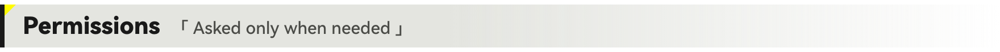

Allow permissions when you use the features that need them:

| Permission | Used for |
| --- | --- |
| **Accessibility** | Letting Work Mode switch macOS Focus through Control Center. The timer works without it. |
| **System Audio Recording** | Experimental per-app volume on macOS 14.2+. Audio isn't saved. |
| **Automation** | Controlling supported music apps when macOS asks. |
| **Notifications** | Update alerts and calendar reminders. |
| **Files and folders** | Opening the files, pictures, and videos you choose. |

> [!TIP]
> You can review permissions in **System Settings → Privacy & Security**; notifications have their own settings page.

 

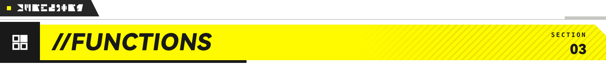

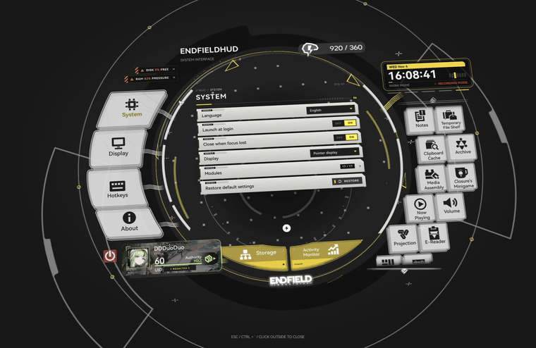

| Tool | What you can do |
| --- | --- |
| [**Notes**](docs/notes-canvas.md) | Write, draw, make checklists, and add images or videos. Pin panels across sections. |
| [**Temporary File Shelf**](docs/file-shelf.md) | Drop files in, preview them, and drag them back out. Originals stay where they are. |
| [**Clipboard Cache**](docs/clipboard-cache.md) | Scroll through recent copied text, links, images, and files. History clears when you quit. |
| [**Archive**](docs/archive.md) | Keep documents in your own categories, with rich text and media. |
| [**App shortcuts**](docs/app-shortcuts.md) | Add your apps with custom names and icons. |

| Tool | What you can do |
| --- | --- |
| [**E-Reader**](docs/reader.md) | Read novels and PDFs, bookmark pages, and zoom in. |
| [**Media Assembly**](docs/media-assembly.md) | Edit pictures and videos with cropping, adjustments, filters, and stickers. |
| [**Projection**](docs/projection.md) | Draw on a screen-sized canvas, with an optional dotted background. |
| [**Now Playing**](docs/now-playing.md) | See album art and available lyrics, and control playback. |

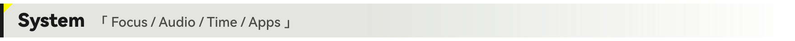

| Tool | What you can do |
| --- | --- |
| [**Work Mode & Volume**](docs/audio-and-work-mode.md) | Enter Focus mode, switch audio devices, and [adjust supported volume controls](docs/per-app-audio.md). |
| [**Calendar**](docs/calendar.md) | Run a timer or stopwatch, and keep events with reminders. |
| [**Battery, Storage & Activity Monitor**](docs/storage-and-activity.md) | Check charging status, disk space, CPU, RAM, and running apps. |

| Tool | What you can do |
| --- | --- |
| [**Map**](docs/map.md) | Explore the offline terrain map and place and customize pins. |
| [**Closure's Minigame**](docs/orbipom-runtime.md) | Play Merge! OrbiPom! |
| [**Event Log**](docs/event-log.md) | Check the event log like a real Endministrator. |
| [**Personal ID**](docs/personal-profile.md) | Customize your card. You can edit profile data freely. |
| [**Account Binding**](docs/account-linking.md) | Link a HYPERGRYPH game account for profile data and sanity countdowns. |

※ Linking is optional.

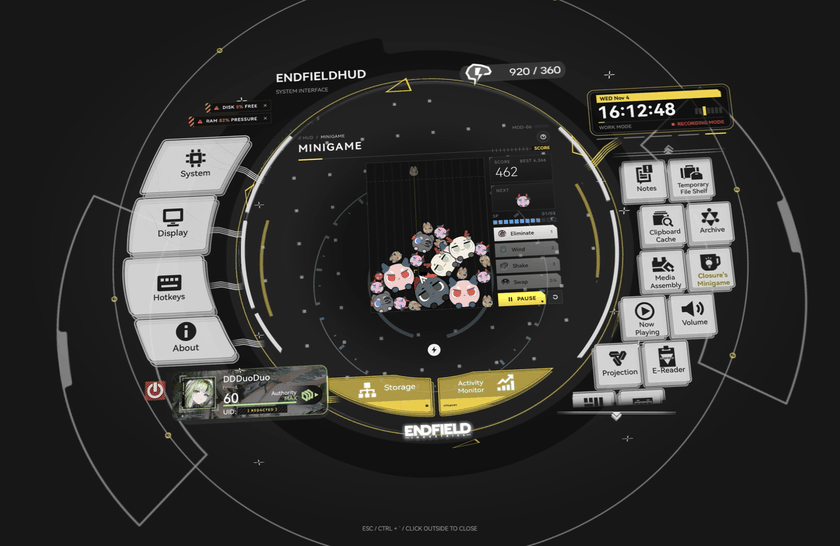

<table>
<tr>
<td width="120"></td>
<td>In <a href="docs/settings.md"><b>Settings</b></a>, change the theme, tilt, clock, icons, and animation settings.</td>
</tr>
<tr>
<td></td>
<td>The HUD supports English, Simplified Chinese, Traditional Chinese, Japanese, and Korean.</td>
</tr>
<tr>
<td></td>
<td>Your notes and settings stay on your Mac. Linked community credentials use macOS Keychain. Updates come from GitHub; check the menu bar or <b>About</b> for update controls.</td>
</tr>
</table>

 

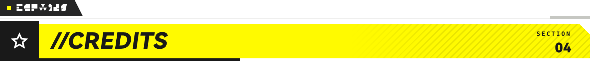

<table>
<tr>
<td width="120"></td>
<td><a href="https://github.com/DDDuoDuo">DDDuoDuo</a></td>
</tr>
<tr>
<td></td>
<td><i>Arknights: Endfield</i>, <a href="https://github.com/QinAnze/zmd-charge">QinAnze</a>, and <a href="https://www.bilibili.com/video/BV1DBaP6yEHs/">llynxxx</a></td>
</tr>
<tr>
<td></td>
<td>Original code is <a href="LICENSE">MIT licensed</a>; third-party assets and libraries keep their own terms. <a href="CREDITS.md">Full credits</a></td>
</tr>
</table>

※ An unofficial fan project. Game artwork and branding belong to HYPERGRYPH and their respective owners.

 

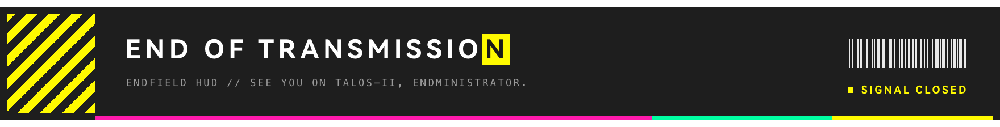

