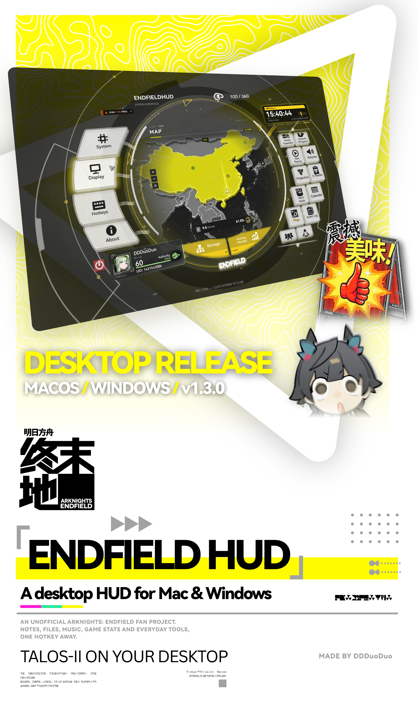
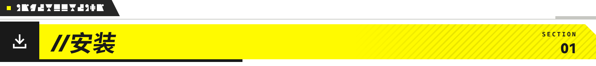
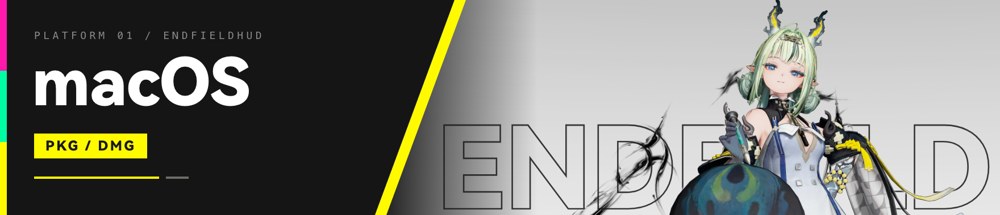
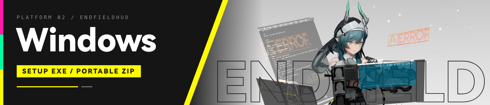
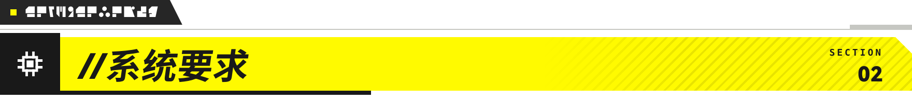
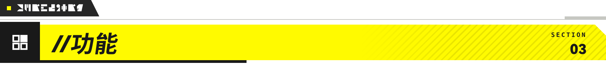
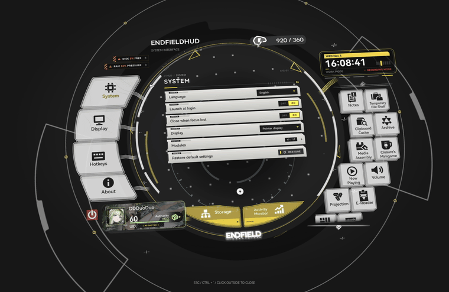
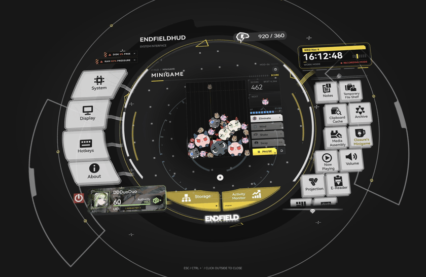
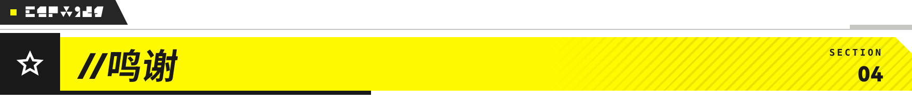
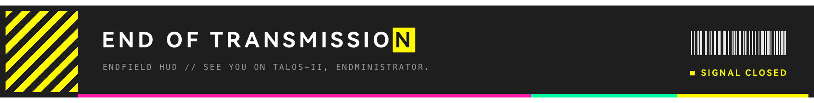

  
  
  
  
  

  
  
  
  
  

  一款能让你成为真正的管理员的软件 
  只需要按快捷键或点击菜单栏，就可以打开终末地的终端——你可以记便笺、放文件、听音乐、看游戏数据，以及使用各种日常小工具

 

※ EndfieldHUD 会出现在菜单栏里。按一下快捷键，HUD 就会出现在所有软件的上方

<table>
<tr>
<td width="120"></td>
<td><a href="https://github.com/DDDuoDuo/EndfieldHUD/releases/download/v1.3.0/EndfieldHUD-1.3.0-build19-Installer.pkg"><b>PKG 安装包</b></a> / <a href="https://github.com/DDDuoDuo/EndfieldHUD/releases/download/v1.3.0/EndfieldHUD-1.3.0-build19-macOS.dmg"><b>DMG</b></a> / <a href="https://github.com/DDDuoDuo/EndfieldHUD/releases">所有版本</a></td>
</tr>
<tr>
<td></td>
<td>已经装过 EndfieldHUD 了？在菜单栏点击<b>检查更新</b></td>
</tr>
<tr>
<td></td>
<td>1. 打开 DMG，把 <b>EndfieldHUD.app</b> 拖进 <b>Applications（应用程序）</b>，也可以运行 PKG 安装包。 2. 从“应用程序”打开 EndfieldHUD，菜单栏里会出现它的图标</td>
</tr>
<tr>
<td></td>
<td>按 <kbd>Ctrl</kbd> + <kbd>`</kbd> 打开 HUD（<a href="docs/system-overlay.md">原理说明</a>）。快捷键可以到<b>设置</b>里修改</td>
</tr>
</table>

> [!WARNING]
> 如果 macOS 拦住了应用，到**系统设置 → 隐私与安全性 → 仍要打开**，再确认一次。这是因为应用目前还没有经过 Apple 公证

 

※ 在 Windows 上，EndfieldHUD 待在通知区域（系统托盘）里。同样的 HUD，同样的快捷键

<table>
<tr>
<td width="120"></td>
<td><a href="https://github.com/DDDuoDuo/EndfieldHUD/releases/download/v1.3.0/EndfieldHUD-1.3.0-build19-windows-x64-setup.exe"><b>安装程序（EXE）</b></a> / <a href="https://github.com/DDDuoDuo/EndfieldHUD/releases/download/v1.3.0/EndfieldHUD-1.3.0-build19-windows-x64-portable.zip"><b>便携版（ZIP）</b></a> / <a href="https://github.com/DDDuoDuo/EndfieldHUD/releases">所有版本</a></td>
</tr>
<tr>
<td></td>
<td>已经装过 EndfieldHUD 了？在<b>关于</b>里点击<b>检查更新</b>，或者直接运行新版安装程序覆盖安装，数据会保留</td>
</tr>
<tr>
<td></td>
<td>1. 运行安装程序（不需要管理员权限），跟着屏幕上的提示安装。安装完后会在“开始”菜单里加上 EndfieldHUD。 2. 想开机时自动启动就勾选<b>登录时启动</b>。然后点<b>安装</b>，再点<b>打开 EndfieldHUD</b></td>
</tr>
<tr>
<td></td>
<td>图标会在通知区域（系统托盘），不在菜单栏。和 Mac 一样，按 <kbd>Ctrl</kbd> + <kbd>`</kbd> 打开 HUD，快捷键可以到<b>快捷键</b>里修改</td>
</tr>
<tr>
<td></td>
<td>不想安装？下载ZIP版，解压到任意位置，运行 <b>EndfieldHUD.exe</b> 即可。不过软件并不会加到“开始”菜单，你也收不到日历提醒通知</td>
</tr>
<tr>
<td></td>
<td>要卸载的话，到<b>设置 → 应用 → 已安装的应用 → EndfieldHUD → 卸载</b>。除非勾选<b>同时删除我的 EndfieldHUD 数据</b>，否则数据都会保留</td>
</tr>
</table>

> [!WARNING]
> 如果 Windows SmartScreen 弹出**Windows 已保护你的电脑**，点**更多信息 → 仍要运行**。这是因为应用目前还没有进行签名

 

<table>
<tr>
<td width="120"></td>
<td>用两侧按钮切换功能，右侧可滚动。<b>Esc</b> 会先退出编辑，再关闭 HUD。关闭 HUD 后应用仍会运行；点击红色电源按钮或右键菜单栏处的图标可以退出应用</td>
</tr>
</table>

 

<table>
<tr>
<td width="120"></td>
<td>苹果 M 系列芯片：<b>macOS 11+</b>。Intel：<b>macOS 10.15.4+</b>。部分功能需要更新的系统或支持的硬件</td>
</tr>
<tr>
<td></td>
<td><b>Windows 11 64 位（x64）</b>，不支持 Windows 10 和 ARM64。需要支持 Direct3D 11 的显卡，以及大约 64 MiB 磁盘空间</td>
</tr>
</table>

用到相关功能时，再允许它需要的权限：

| 权限 | 用来做什么 |
| --- | --- |
| **辅助功能** | 让工作模式通过控制中心切换 macOS 专注模式。不授权也能用计时器 |
| **系统音频录制** | macOS 14.2+ 的实验性独立应用音量控制。不会保存音频 |
| **自动化** | 在 macOS 提示时，允许控制支持的音乐应用 |
| **通知** | 更新提醒和日历提醒 |
| **文件与文件夹** | 打开你选择的文件、图片和视频 |

> [!TIP]
> 权限可以在**系统设置 → 隐私与安全性**里查看；通知有单独的设置页面

 

| 工具 | 可以做什么 |
| --- | --- |
| [**便笺**](docs/notes-canvas.md) | 写字、画画、待办列表，还能添加图片或视频。把面板固定后切换到别的模块不会消失 |
| [**文件暂存架**](docs/file-shelf.md) | 拖入、预览文件，还能再拖出来。原文件保留在原本的位置 |
| [**剪贴板**](docs/clipboard-cache.md) | 滚动查看最近复制的文字、链接、图片和文件。退出应用后清空历史 |
| [**档案库**](docs/archive.md) | 按自己的分类保存文档，支持富文本和图片、视频 |
| [**应用快捷方式**](docs/app-shortcuts.md) | 添加自己的应用，自定义名称和图标 |

| 工具 | 可以做什么 |
| --- | --- |
| [**阅读器**](docs/reader.md) | 看小说和 PDF，加书签，放大页面 |
| [**影像加工**](docs/media-assembly.md) | 裁剪、调整图片和视频，添加滤镜和贴纸 |
| [**投影**](docs/projection.md) | 在全屏画布上画画，也可以打开点阵背景 |
| [**当前播放**](docs/now-playing.md) | 看专辑封面和可用的歌词，控制播放 |

| 工具 | 可以做什么 |
| --- | --- |
| [**工作模式与音量**](docs/audio-and-work-mode.md) | 进入专注模式，切换音频设备，[调整设备支持的音量选项](docs/per-app-audio.md) |
| [**日历**](docs/calendar.md) | 用倒计时或秒表，记录日程并设置提醒 |
| [**电源、存储与活动监视器**](docs/storage-and-activity.md) | 查看充电状态、磁盘空间、CPU、RAM 和运行中的应用 |

| 工具 | 可以做什么 |
| --- | --- |
| [**地图**](docs/map.md) | 探索离线地形图，添加并自定义标记 |
| [**可露希尔的小游戏**](docs/orbipom-runtime.md) | 玩融合！山团团！ |
| [**事件日志**](docs/event-log.md) | 像真正的管理员一样查看事件日志 |
| [**个人名片**](docs/personal-profile.md) | 自定义名片，自由编辑个人资料 |
| [**账号绑定**](docs/account-linking.md) | 绑定鹰角游戏账号，同步资料和理智倒计时 |

※ 账号绑定可选

<table>
<tr>
<td width="120"></td>
<td>在<a href="docs/settings.md"><b>设置</b></a>里可以改主题、倾斜、时钟、图标和动画设置</td>
</tr>
<tr>
<td></td>
<td>HUD 支持英语、简体中文、繁体中文、日语和韩语</td>
</tr>
<tr>
<td></td>
<td>便笺和设置都留在你的 Mac 上。绑定后的社区凭据保存在 macOS 钥匙串里。更新来自 GitHub；菜单栏和<b>关于</b>里都有更新选项</td>
</tr>
</table>

 

<table>
<tr>
<td width="120"></td>
<td><a href="https://github.com/DDDuoDuo">DDDuoDuo</a></td>
</tr>
<tr>
<td></td>
<td>《明日方舟：终末地》、<a href="https://github.com/QinAnze/zmd-charge">QinAnze</a> 和 <a href="https://www.bilibili.com/video/BV1DBaP6yEHs/">llynxxx</a></td>
</tr>
<tr>
<td></td>
<td>原创代码采用 <a href="LICENSE">MIT 许可证</a>，第三方素材和库保留各自的许可条款。<a href="CREDITS.md">完整鸣谢</a></td>
</tr>
</table>

※ 这是一个非官方同人项目。游戏素材和品牌标识归鹰角网络及各自的权利人所有

 

