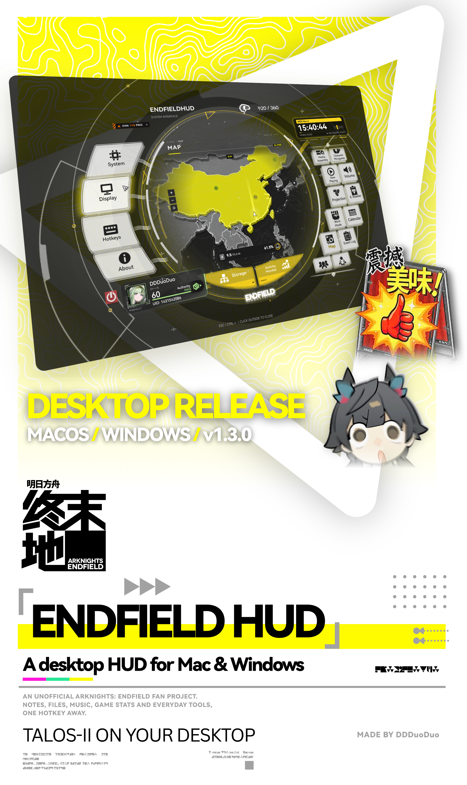
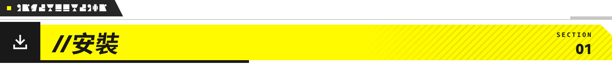
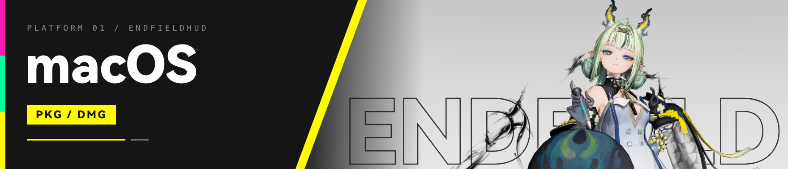
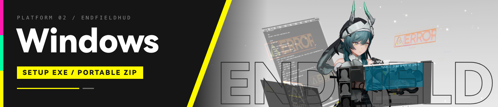
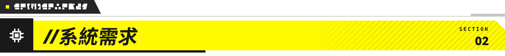
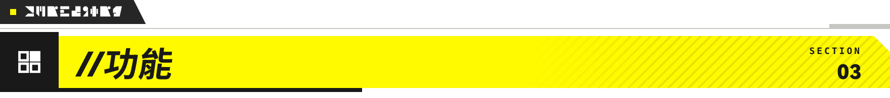
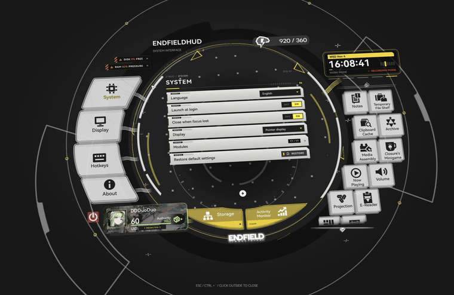
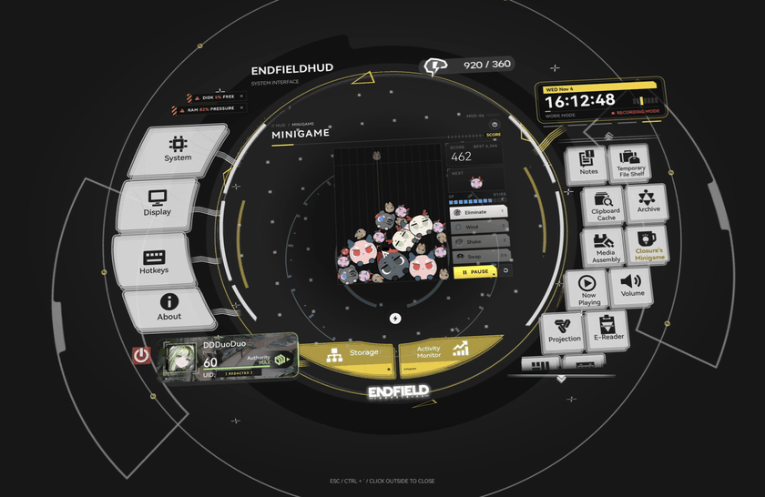
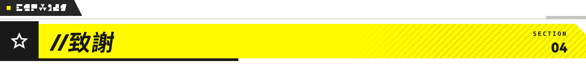
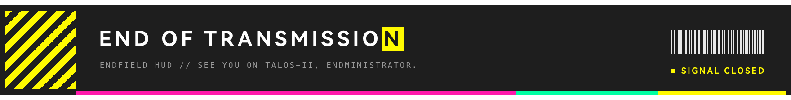

  
  
  
  
  

  
  
  
  
  

  一款能讓你成為真正的管理員的軟體 
  只需要按快速鍵或點選選單列，就能開啟終末地的終端——你可以寫便箋、放檔案、聽音樂、看遊戲資料，以及使用各種日常小工具

 

※ EndfieldHUD 會出現在選單列裡。按一下快速鍵，HUD 就會出現在所有軟體的上方

<table>
<tr>
<td width="120"></td>
<td><a href="https://github.com/DDDuoDuo/EndfieldHUD/releases/download/v1.3.0/EndfieldHUD-1.3.0-build19-Installer.pkg"><b>PKG 安裝程式</b></a> / <a href="https://github.com/DDDuoDuo/EndfieldHUD/releases/download/v1.3.0/EndfieldHUD-1.3.0-build19-macOS.dmg"><b>DMG</b></a> / <a href="https://github.com/DDDuoDuo/EndfieldHUD/releases">所有版本</a></td>
</tr>
<tr>
<td></td>
<td>已經裝過 EndfieldHUD 了？在選單列點選<b>檢查更新</b></td>
</tr>
<tr>
<td></td>
<td>1. 開啟 DMG，把 <b>EndfieldHUD.app</b> 拖進 <b>Applications（應用程式）</b>，也可以執行 PKG 安裝程式。 2. 從「應用程式」開啟 EndfieldHUD，選單列裡會出現它的圖示</td>
</tr>
<tr>
<td></td>
<td>按 <kbd>Ctrl</kbd> + <kbd>`</kbd> 開啟 HUD（<a href="docs/system-overlay.md">運作方式</a>）。快速鍵可以到<b>設定</b>裡修改</td>
</tr>
</table>

> [!WARNING]
> 如果 macOS 擋住了 App，到**系統設定 → 隱私權與安全性 → 強制打開**，再確認一次。這是因為 App 目前還沒有經過 Apple 公證

 

※ 在 Windows 上，EndfieldHUD 待在通知區域（系統匣）裡。同樣的 HUD，同樣的快速鍵

<table>
<tr>
<td width="120"></td>
<td><a href="https://github.com/DDDuoDuo/EndfieldHUD/releases/download/v1.3.0/EndfieldHUD-1.3.0-build19-windows-x64-setup.exe"><b>安裝程式（EXE）</b></a> / <a href="https://github.com/DDDuoDuo/EndfieldHUD/releases/download/v1.3.0/EndfieldHUD-1.3.0-build19-windows-x64-portable.zip"><b>免安裝版（ZIP）</b></a> / <a href="https://github.com/DDDuoDuo/EndfieldHUD/releases">所有版本</a></td>
</tr>
<tr>
<td></td>
<td>已經裝過 EndfieldHUD 了？在<b>關於</b>裡點選<b>檢查更新</b>，或直接執行新版安裝程式覆蓋安裝，資料會保留</td>
</tr>
<tr>
<td></td>
<td>1. 執行安裝程式（不需要系統管理員權限），跟著螢幕上的提示安裝。安裝完後會在「開始」功能表加入 EndfieldHUD。 2. 想開機時自動啟動就勾選<b>登入時啟動</b>。接著點<b>安裝</b>，再點<b>開啟 EndfieldHUD</b></td>
</tr>
<tr>
<td></td>
<td>圖示會在通知區域（系統匣），不在選單列。跟 Mac 一樣，按 <kbd>Ctrl</kbd> + <kbd>`</kbd> 開啟 HUD，快速鍵可以到<b>快速鍵</b>裡修改</td>
</tr>
<tr>
<td></td>
<td>不想安裝？下載 ZIP 版，解壓縮到任何位置，執行 <b>EndfieldHUD.exe</b> 即可。不過軟體並不會加入「開始」功能表，你也收不到日曆提醒通知</td>
</tr>
<tr>
<td></td>
<td>要解除安裝，到<b>設定 → 應用程式 → 已安裝的應用程式 → EndfieldHUD → 解除安裝</b>。除非勾選<b>同時刪除我的 EndfieldHUD 資料</b>，否則資料都會保留</td>
</tr>
</table>

> [!WARNING]
> 如果 Windows SmartScreen 跳出**Windows 已保護您的電腦**，點**其他資訊 → 仍要執行**。這是因為 App 目前還沒有進行簽署

 

<table>
<tr>
<td width="120"></td>
<td>用兩側按鈕切換功能，右側可捲動。<b>Esc</b> 會先離開編輯，再關閉 HUD。關閉 HUD 後 App 仍會執行；點選紅色電源按鈕或在選單列的圖示上按右鍵可以結束 App</td>
</tr>
</table>

 

<table>
<tr>
<td width="120"></td>
<td>蘋果 M 系列晶片：<b>macOS 11+</b>。Intel：<b>macOS 10.15.4+</b>。部分功能需要較新的系統或支援的硬體</td>
</tr>
<tr>
<td></td>
<td><b>Windows 11 64 位元（x64）</b>，不支援 Windows 10 和 ARM64。需要支援 Direct3D 11 的顯示卡，以及大約 64 MiB 磁碟空間</td>
</tr>
</table>

用到相關功能時，再允許它需要的權限：

| 權限 | 用來做什麼 |
| --- | --- |
| **輔助使用** | 讓工作模式透過控制中心切換 macOS 專注模式。不授權也能用計時器 |
| **系統音訊錄製** | macOS 14.2+ 的實驗性個別 App 音量控制。不會儲存音訊 |
| **自動化** | 在 macOS 提示時，允許控制支援的音樂 App |
| **通知** | 更新提醒和日曆提醒 |
| **檔案與檔案夾** | 開啟你選擇的檔案、圖片和影片 |

> [!TIP]
> 權限可以在**系統設定 → 隱私權與安全性**裡查看；通知有獨立的設定頁面

 

| 工具 | 可以做什麼 |
| --- | --- |
| [**便箋**](docs/notes-canvas.md) | 寫字、畫畫、待辦清單，還能加入圖片或影片。釘選面板後切換到別的模組不會消失 |
| [**檔案暫存架**](docs/file-shelf.md) | 拖入、預覽檔案，還能再拖出來。原始檔案保留在原本的位置 |
| [**剪貼簿**](docs/clipboard-cache.md) | 捲動查看最近複製的文字、連結、圖片和檔案。結束 App 後清空記錄 |
| [**檔案庫**](docs/archive.md) | 按自己的分類儲存文件，支援格式化文字和圖片、影片 |
| [**App 捷徑**](docs/app-shortcuts.md) | 加入自己的 App，自訂名稱和圖示 |

| 工具 | 可以做什麼 |
| --- | --- |
| [**閱讀器**](docs/reader.md) | 看小說和 PDF，加書籤，放大頁面 |
| [**影像加工**](docs/media-assembly.md) | 裁切、調整圖片和影片，加入濾鏡和貼紙 |
| [**投影**](docs/projection.md) | 在全螢幕畫布上畫畫，也可以開啟點陣背景 |
| [**目前播放**](docs/now-playing.md) | 看專輯封面和可用的歌詞，控制播放 |

| 工具 | 可以做什麼 |
| --- | --- |
| [**工作模式與音量**](docs/audio-and-work-mode.md) | 進入專注模式，切換音訊裝置，[調整裝置支援的音量選項](docs/per-app-audio.md) |
| [**日曆**](docs/calendar.md) | 用倒數計時或碼錶，記錄行程並設定提醒 |
| [**電源、儲存與活動監視器**](docs/storage-and-activity.md) | 查看充電狀態、磁碟空間、CPU、RAM 和執行中的 App |

| 工具 | 可以做什麼 |
| --- | --- |
| [**地圖**](docs/map.md) | 探索離線地形圖，加入並自訂標記 |
| [**可露希爾的小遊戲**](docs/orbipom-runtime.md) | 玩融合！山團團！ |
| [**事件記錄**](docs/event-log.md) | 像真正的管理員一樣查看事件記錄 |
| [**個人名片**](docs/personal-profile.md) | 自訂名片，自由編輯個人資料 |
| [**帳號綁定**](docs/account-linking.md) | 綁定鷹角遊戲帳號，同步資料和理智倒數 |

※ 帳號綁定可選

<table>
<tr>
<td width="120"></td>
<td>在<a href="docs/settings.md"><b>設定</b></a>裡可以改主題、傾斜、時鐘、圖示和動畫設定</td>
</tr>
<tr>
<td></td>
<td>HUD 支援英語、簡體中文、繁體中文、日語和韓語</td>
</tr>
<tr>
<td></td>
<td>便箋和設定都留在你的 Mac 上。綁定後的社群憑證儲存在 macOS 鑰匙圈裡。更新來自 GitHub；選單列和<b>關於</b>裡都有更新選項</td>
</tr>
</table>

 

<table>
<tr>
<td width="120"></td>
<td><a href="https://github.com/DDDuoDuo">DDDuoDuo</a></td>
</tr>
<tr>
<td></td>
<td>《明日方舟：終末地》、<a href="https://github.com/QinAnze/zmd-charge">QinAnze</a> 和 <a href="https://www.bilibili.com/video/BV1DBaP6yEHs/">llynxxx</a></td>
</tr>
<tr>
<td></td>
<td>原創程式碼採用 <a href="LICENSE">MIT 授權</a>，第三方素材和函式庫保留各自的授權條款。<a href="CREDITS.md">完整致謝</a></td>
</tr>
</table>

※ 這是一個非官方同人專案。遊戲素材和品牌標誌歸鷹角網路及各自的權利人所有

 

